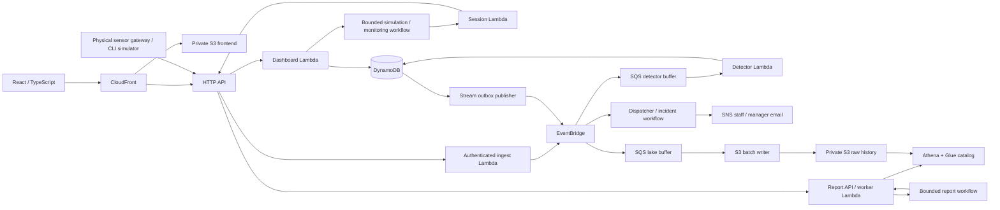

# Cold-Chain Monitor

AWS cold-chain operations MVP for the ESADE Cloud Solutions project.
**The original dev platform is deployed. The React MVP update is undergoing deployment verification.**

[Open the workspace](https://dazwahczj9j0k.cloudfront.net) and copy the operator key locally:

```bash
pbcopy < .local/dashboard-credential-dev.txt
```

The update adds a React/TypeScript frontend, versioned device settings, incident
assignments and corrective actions, six realistic simulation scenarios, backend
silence detection and on-demand historical reports. It continues to use private
S3 and CloudFront; there is no frontend server or Amplify subscription.

## Using the MVP

| View | What you can do |
|---|---|
| Overview | Filter sites/devices, inspect temperatures and threshold bands, open unit details, export recent readings, view a schematic site layout |
| Devices | Configure five preprovisioned slots: names, sites, equipment, max/min threshold, expected interval, enabled state and simulated/physical source |
| Incidents | Inspect detection/notification/recovery timelines, acknowledge, assign a responder, add notes and corrective actions |
| Simulation lab | Run normal operation, a spike, door opening, compressor failure, warming or disconnection; alternatively monitor physical devices without generating readings |
| Analytics | Request a bounded Athena report for 1h/24h/7d; inspect temperatures, estimated excursion/coverage durations and response times; export CSV |

Simulation sessions run **on the backend**, including after the tab closes.
Use **Stop session** to stop future ticks; a request already in flight can finish.
Each session lasts at most ten minutes and generates at most 100 distinct readings
before finite retries. One session runs at a time; ten starts per UTC day are
allowed. The default is five devices, 30 seconds per unit, up to 100 readings.
The lab compares expected and observed incident/recovery outcomes for each run.
Faster mode uses at least ten seconds per unit and retains the same limits.
Only the first selected device receives the failure; the others provide a normal
baseline. Curves are deterministic teaching approximations, not trained models.
Email alerts are real. Do not run the CLI simulator alongside a backend session.

Physical monitoring is armed only for the bounded session. Missing fresh readings
for more than `max(90 seconds, 3 × expected interval)` opens one separate offline
incident. Fresh telemetry recovers it; stopping monitoring closes it with recovery
**unverified**. A reporting interval longer than the session may prevent silence
detection in that session. Offline means no fresh processed telemetry; it cannot
by itself distinguish a dead sensor from a failed network or processing path.

Live UI polling pauses after ten minutes; Refresh resumes it. Charts retain the
latest 20 accepted samples and five incidents per unit. Full raw history is in the
lake for fourteen days. Historical durations use a sample-and-hold estimate only
across gaps no longer than the configured silence threshold. Window edges, long
gaps and legacy readings without rule metadata remain unknown. Reports reuse
identical results for five minutes, allow one query at a time and at most twenty
starts per UTC day. The workgroup enforces a 10 MiB scan limit; a bounded workflow
requests cancellation after sixty seconds. Cancellation is best effort.

Device settings apply to subsequent ingestion and have optimistic revisions.
Terraform manages device slots and secret paths; runtime settings are application data.
Rule changes reset the counter; queued older rule revisions cannot affect the new
hot state. Stop sessions and recover open temperature incidents before editing.
Changing source/site clears the displayed sample history while preserving the
replay watermark. The source label reflects configuration, not hardware attestation.
Device keys never reach the browser; the shared operator key stays in tab memory.
Responder names are operator-entered labels, not verified user identities.

## Architecture and decisions



Three timestamp-increasing out-of-range readings open one temperature incident;
a normal sample resets the sequence and resolves it. A spike alone does not.
Older/equal timestamps are ignored; missing gaps over the silence threshold reset
the sequence. This means consecutive **accepted** samples, not reconstructed
unordered sensor history. Readings already stale at ingestion are archived but
do not change current health. Default maxima are 5°C for fridges and -18°C for
freezers: project settings, not regulatory guidance. Detection requires multiple
samples plus asynchronous processing time.

UNIT state, changed incident records, deduplication and outbox events commit in
one DynamoDB transaction with bounded optimistic retries. Reading IDs survive
HTTP retries. Downstream delivery/email remain at least once. The incident
Standard workflow checks every thirty seconds, escalates after 120 seconds and
supports late acknowledgement. Incident-scoped links expire after one hour;
GET displays confirmation and only POST acknowledges. Recovery suppresses pending
escalation; an in-flight email cannot be recalled. Acknowledgement does not imply
temperature recovery. Notes/assignments use stable request IDs and the same outbox;
activity is bounded to twenty entries per incident, five recent incidents per unit.
Unchanged incident snapshots are not re-written on every reading.

Session/report startup uses a committed lease and a stable Standard execution
name/input. A caller failure between those operations can delay startup; retries
reuse the name, and abandoned leases expire or are recovered. Retried simulation
ticks preserve reading bytes and IDs. Progress commits after ingestion, so a crash
can resend a reading, which the detector deduplicates. Stops disable monitoring
immediately; lease checks protect newer sessions from delayed older cleanup.

Departures from the draft: SQS microbatches replace Firehose for low volume;
known Glue schema replaces a crawler; Lambda validates HTTP API JSON; bounded
Wait/Choice loops replace emailed callback tokens. Native encryption and
AWS-managed SNS keys avoid fixed CMK fees. Versioned S3 supports recovery and an
append-only application design; it is not legal immutability. The React UI replaces
QuickSight, with no subscription. Silence checks run only in operator-created
workflows. No recurring producer, crawler, ETL job or query is deployed.

| Course area | Coverage |
|---|---|
| IaC and cloud services | Implemented: reusable Terraform, private S3 state/native locking, API, Lambda, messaging, DynamoDB, workflows, S3/CloudFront |
| Git-managed delivery | Implemented: SHA-pinned GitHub checks/artifacts and reviewed local saved-plan apply; account policy blocks OIDC |
| Event processing/reliability | Implemented: buffering, transactional outbox, deduplication, concurrency, escalation, bounded simulation and silence monitoring |
| Data processing | Implemented: S3 raw lake, explicit Glue schema, on-demand Athena aggregation, coverage/gap analysis and CSV |
| Observability | Implemented: correlated JSON logs, thirteen alarms, sampled native traces; asynchronous boundaries remain separate |
| Optional depth | Not enabled: curated Parquet/ETL, statistical maintenance trends, longer physical monitoring, per-user authentication |
| Future work | Real sensor drivers/calibration, MQTT/IoT certificates, multi-tenancy, trained ML/GenAI; none claimed as deployed |

## Local development and verification

Requires Python 3.13, Node 22.12+ or 24+, npm and Terraform **1.17.0**.
AWS credentials are unnecessary for local tests and mocked browser checks.

```bash
python3 -m venv .venv
.venv/bin/python -m pip install --require-hashes -r requirements-dev.lock
npm ci --prefix app/web --ignore-scripts
npm run check --prefix app/web
# After deployment, optional local frontend development (proxies the deployed API):
# npm run dev --prefix app/web
npm audit --prefix app/web --omit=dev --audit-level=high
.venv/bin/python scripts/check_frontend_audit.py
.venv/bin/ruff check app simulator scripts tests
.venv/bin/ruff format --check app simulator scripts tests
.venv/bin/pytest -q
.venv/bin/python scripts/check_reproducibility.py
.venv/bin/python -m scripts.demo_local
terraform fmt -check -recursive infra
.venv/bin/python -m pip install --require-hashes -r requirements-browser.lock
.venv/bin/python -m playwright install chromium
.venv/bin/python scripts/check_dashboard_browser.py
```

Run `init -backend=false -lockfile=readonly` and `validate` in each Terraform root;
`terraform test` in bootstrap and platform uses mocked providers, with no AWS writes.
The browser check serves the actual React production build with a local mocked API.
It tests authentication, charts, stable retries, incident actions, device editing,
sessions, reports/CSV, responsive views, polling deadlines and disconnect clearing.
**96 Python tests**, mocked Terraform contracts, four root validations and the
React desktop/mobile browser checks passed locally. Screenshots/evidence stay
ignored in `.local/`. Local checks do not prove AWS
integration or physical sensor operation.

Security gates include Python runtime auditing and Trivy IaC/secret checks; three
specific infrastructure exceptions are in `.trivyignore.yaml`. Browser dependencies
have no reported vulnerabilities at the last check. Vite's **build-only** picomatch
chain has [an unpatched ReDoS advisory](https://github.com/advisories/GHSA-fc5q-39xc-vjpf).
The narrow exception expires 18 December 2026; new high/critical advisories fail
`scripts/check_frontend_audit.py`. No Vite server is deployed, browser input never
reaches build glob patterns, and CI has no AWS credentials. CSP permits inline
**styles** for chart positioning; scripts remain same-origin without inline script
or eval. Recharts loads only when a detailed chart is opened.

Historical AWS evidence, 17 November 2026: the original 100-reading rehearsal
plus one duplicate passed detection, escalation, late acknowledgement and recovery;
the owner confirmed staff/manager emails. Athena returned 100 distinct readings
and five lifecycle events, scanning 53,684 bytes. The original dashboard also
passed a ten-reading browser smoke test, including acknowledgement/recovery and
mobile/chart/CSV. Anonymous API access returned 401; direct S3 returned 403. Queues
and all five DLQs drained. Fault injection/redrive was tested locally, not on AWS.
These results do **not** verify the new MVP's cloud integrations before deployment.

## Account, budget and cost

Account **028718095604**, primary region **eu-north-1**, temporary browser profile
`coldchain-console`. Helpers verify STS, reject root/account mismatches and pass
credentials in memory. No static keys or runtime-secret values enter Git or
Terraform state. `COLDCHAIN_PROFILE` can select another authorized temporary profile.

Read-only evidence on **18 November 2026**: ACTIVE Free plan, **$160 reported
remaining credits**, plan expiry **17 May 2027**, account Lambda concurrency 400.
Cost Explorer returned **$0 estimated**, excluding credits/refunds, for 17–18 Nov;
usage reporting is delayed and free allowances may already reduce this figure.
Detailed credit eligibility and individual expiry remain unverified due to billing
restrictions. No upgrade, subscription, trial or billing-setting change is authorized.

The reproducible estimate is `scripts/estimate_cost.py`; full dated tariff evidence
and calculations remain private in `.local/`. It includes requests, a 10% retry
allowance, 128 MiB/two-second Lambda calls, heavily populated 192 KiB unit records,
transactional writes/consistent reads, conservative idle SQS polling, workflow
transitions, storage, logs, thirteen alarms, full trace-sampling upper estimate,
KMS operations, query scans and European data transfer. No custom metrics are added.

| Updated MVP workload | Estimated gross USD before credits/free allowances |
|---|---:|
| One 100-reading demo + report, one hour deployed | 0.07 |
| Thirty days idle | 1.82 |
| Thirty days, thirty bounded sessions + thirty reports, 2 GB CDN/20k HTTPS requests | 3.90 |
| Thirty days of repeated starts at daily limits: 300 sessions/30k readings + 600 reports, 20 GB CDN/200k HTTPS requests | 23.55 |

Allow **$6 for a month of light use**, including a planning buffer and a few Cost
Explorer calls; preserve the **$25 total project target and $50 credit reserve**.
Eligible usage is expected to consume credits. No cash charge is expected while
this Free plan remains active and eligible; missing a payment card is not the
control. Taxes, unrelated usage, abuse, retry storms and physical/CLI traffic outside
dashboard limits are excluded or uncertain. Notifications, throttles, scan limits
and quotas are protective layers, not hard spending caps. Optional free allowances
can lower actual charges. The daily limits prevent the dashboard's normal controls
from running a generator continuously; a compromised credential remains a risk.

Official prices checked 18 November 2026:
[Stockholm Lambda tariffs](https://pricing.us-east-1.amazonaws.com/offers/v1.0/aws/AWSLambda/current/eu-north-1/index.json),
[DynamoDB](https://aws.amazon.com/dynamodb/pricing/on-demand/),
[Step Functions](https://aws.amazon.com/step-functions/pricing/),
[SQS](https://aws.amazon.com/sqs/pricing/), [SNS](https://aws.amazon.com/sns/pricing/),
[CloudWatch](https://aws.amazon.com/cloudwatch/pricing/),
[Athena](https://aws.amazon.com/athena/pricing/), [Glue](https://aws.amazon.com/glue/pricing/),
[S3](https://aws.amazon.com/s3/pricing/), [KMS](https://aws.amazon.com/kms/pricing/),
[X-Ray](https://aws.amazon.com/xray/pricing/),
[API Gateway](https://aws.amazon.com/api-gateway/pricing/),
[EventBridge](https://aws.amazon.com/eventbridge/pricing/),
[CloudFront pay-as-you-go](https://aws.amazon.com/cloudfront/pricing/pay-as-you-go/).
SQS's maximum-concurrency setting prevents its lowest-idle-poller optimization;
[DynamoDB-to-Lambda stream polling has no Streams request charge](https://docs.aws.amazon.com/amazondynamodb/latest/developerguide/CostOptimization_StreamsUsage.html).
CloudFront is global; origins remain in Stockholm. No flat-rate plan, custom domain,
edge function, WAF subscription or always-on compute is enabled.

The existing deployment has **7 bootstrap + 124 application/configuration resources**
and seven runtime SecureStrings. The update adds two Lambda functions, two Standard
workflows, scoped roles/routes and four alarms, plus built React asset changes;
review the saved Terraform plan for the exact inventory. Existing account-wide
actual-spend notifications at $5/$10/$20/$25 and forecast $25 cover **17 Nov–17 Dec**,
exclude credits/refunds and are verified. They are delayed warnings. Budgets uses
us-east-1; IAM/CloudFront are global. State and plans remain private.

## Bootstrap and reviewed deployment

Ignored `local.tfvars.json` files are configured locally. A fresh checkout needs
`{"budget_email":"you@example.com"}` in bootstrap and `{"alert_email":"you@example.com"}`
in the environment. Copy `backend.example.hcl` to ignored `backend.hcl` and set the
approved state bucket. Initial bootstrap requires authorized human credentials.

```bash
aws login --profile coldchain-console --region eu-north-1
.venv/bin/python scripts/preflight.py
# Build application and static assets before planning:
.venv/bin/python scripts/package.py
# First deployment only:
.venv/bin/python scripts/terraform_local.py bootstrap init
.venv/bin/python scripts/terraform_local.py bootstrap plan
# Review and obtain owner approval before applying:
.venv/bin/python scripts/terraform_local.py bootstrap apply --confirm-account 028718095604
aws s3 cp infra/bootstrap/terraform.tfstate s3://coldchain-028718095604-tfstate/recovery/bootstrap.tfstate \
  --sse AES256 --profile coldchain-console --region eu-north-1
# Existing application updates start here:
.venv/bin/python scripts/terraform_local.py dev init
.venv/bin/python scripts/terraform_local.py dev plan
.venv/bin/python scripts/terraform_local.py dev show
.venv/bin/python scripts/terraform_local.py dev apply --confirm-account 028718095604
.venv/bin/python scripts/provision_devices.py --environment dev --confirm-account 028718095604
.venv/bin/python scripts/terraform_local.py dev output
```

Apply verifies clean committed source, frontend/runtime/plan hashes, plan age,
account and explicit confirmation. `dev preview` is isolated and cannot be applied.
Both environment configurations share one locked state key: deploy only one.
Retain bootstrap state on encrypted local storage and in its private recovery
backup; ordinary application destruction preserves the backend. IAM source analysis
was run locally with `iam-policy-autopilot`, then unnecessary actions were removed
and resources narrowed; it did not upload policies.

GitHub CI checks Python, React, dependency locks, browser behaviour, Terraform and
security without AWS credentials. Prepare local delivery builds app + hashed assets
for the exact main commit. OIDC provider operations are blocked by the account's
signup policy; the owner approved reviewed local saved-plan delivery. No static-key
fallback or pretend GitHub approval gate is used. Terraform remains split by service,
including `sessions.tf` and `reports.tf`. Plans/state/secrets/builds, agent context
and `node_modules` are ignored; only this README is retained as project Markdown.

## Physical gateway and demo

Set a device slot's source to Physical and its expected reporting interval to the
hardware's cadence. Securely provision only that device's credential to the gateway;
`.local/device-credentials-dev.json` is the local simulator's all-device file and
should not be copied wholesale to a physical sensor. A per-device file has shape
`{"unit-1":"DEVICE_KEY"}`; protect it with mode 0600 and keep it out of Git.

```bash
.venv/bin/python scripts/export_device.py --unit unit-1 --output .local/unit-1-credentials.json
.venv/bin/python -m simulator.device --endpoint https://REPLACE.execute-api.eu-north-1.amazonaws.com \
  --unit unit-1 --site demo-site --credentials .local/unit-1-credentials.json --temperature 4.2
```

A hardware driver can call `Gateway.enqueue(sensor.read_temperature())`, then
`Gateway.flush()`. SQLite persists IDs before network I/O; flushes stop after at
most 100 measurements and three attempts per measurement. Failed sends remain
queued across process restarts. HTTP/redirects are rejected to protect credentials.
Keep clocks synchronized; ingestion accepts at most a 24-hour backfill. Older
queued records need deliberate operator handling. Backfills are archived and do
not rewind live health. No physical driver or calibration is claimed tested.

Demo sequence: configure a fridge → run Door left open → observe three breaches
and staff notification → wait for manager escalation or acknowledge → assign a
responder/add corrective action → observe temperature recovery → generate a lake
report and export CSV. Separately run Sensor disconnected to demonstrate offline
and fresh-reading recovery. Repeatable scenario outcomes depend on sample count,
interval and asynchronous processing; a short run may not exercise every stage.
Show a small Git change through CI plus JSON logs, DLQ/queue-age alarms and traces.
Domain IDs correlate asynchronous hops; a single complete automatic trace is not
promised. Notification timestamps represent requests, not email delivery receipts.

The bounded CLI demonstration remains available:

```bash
.venv/bin/python -m simulator.run --url https://REPLACE.execute-api.eu-north-1.amazonaws.com \
  --credentials .local/device-credentials-dev.json
.venv/bin/python scripts/query_history.py --environment dev
```

After explicit live-test approval, `scripts/smoke_mvp.py --confirm-account 028718095604 --confirm-live`
runs two bounded sessions (at most thirty distinct readings total) and one historical
report, exercising escalation/late acknowledgement and offline/reconnection. It sends
real emails and retains private evidence. It has not been run for this update yet.

Ctrl-C stops the CLI. In the deployed UI use Stop session for backend producers.
A reviewed Terraform pause sets `ingestion_enabled=false` and
`consumers_enabled=false` without losing state. On a fresh deployment confirm SNS
subscriptions. For missing emails, inspect confirmation, dispatch/async DLQs and
current incident state. Inspect failures before any replay; never redrive blindly.

## Cleanup

Logs retain seven days; raw data fourteen; query results seven; noncurrent S3
versions seven; incomplete multipart uploads one day. DynamoDB dedup/outbox/incident
records have thirty-day TTL. Bounded unit settings/watermarks/recent snapshots
persist until application cleanup. Native account audit history is reused;
CloudTrail data-event logging is not enabled or claimed for every operation.

Cleanup requires explicit data-loss approval: stop sessions/CLI and drain writers,
run `empty_demo_buckets.py --environment dev --confirm-account 028718095604 --confirm-data-loss`,
review `terraform_local.py dev destroy-plan`, then apply that plan with both account
and data-loss flags. Run `cleanup_parameters.py` with matching flags. Only tagged
application resources are targeted. Backend removal requires separate approval and
state export; retained backend versions/logs can continue small storage charges.
No cleanup has been executed.
